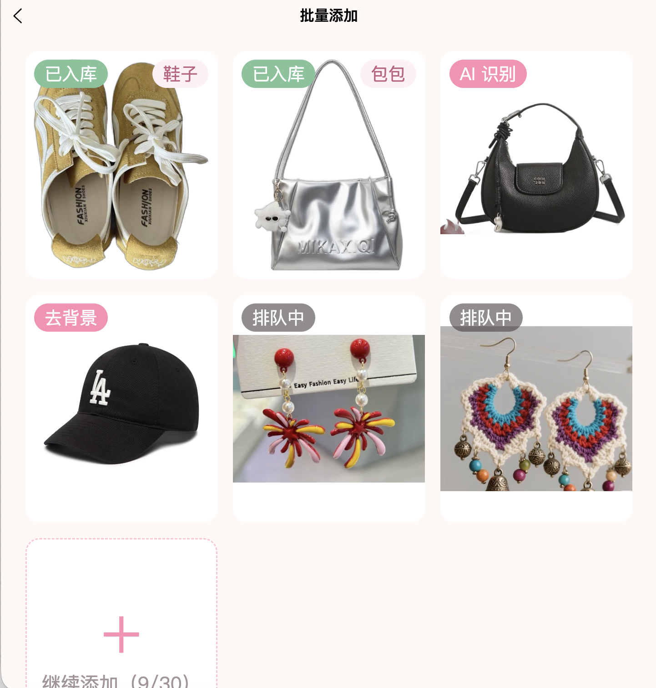
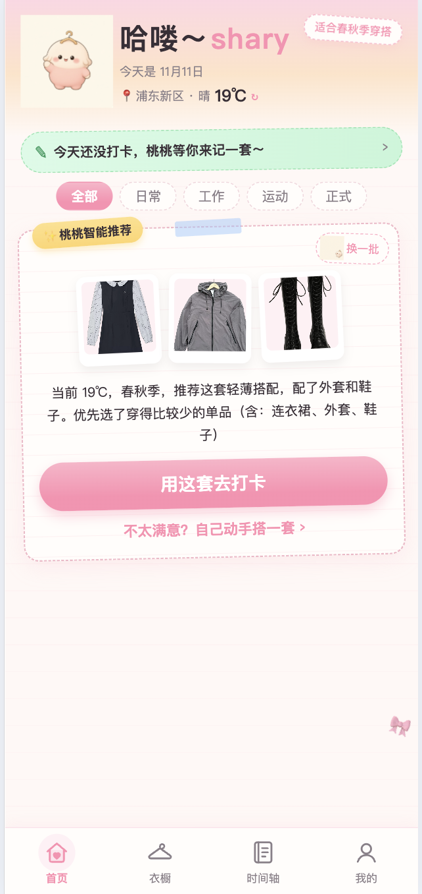
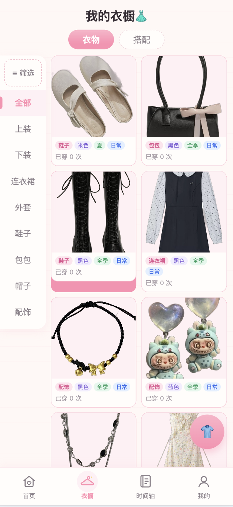
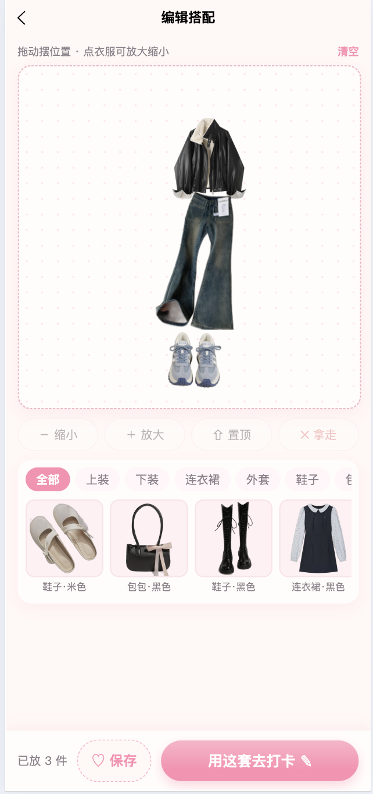
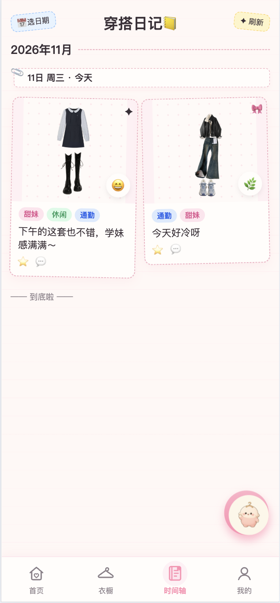
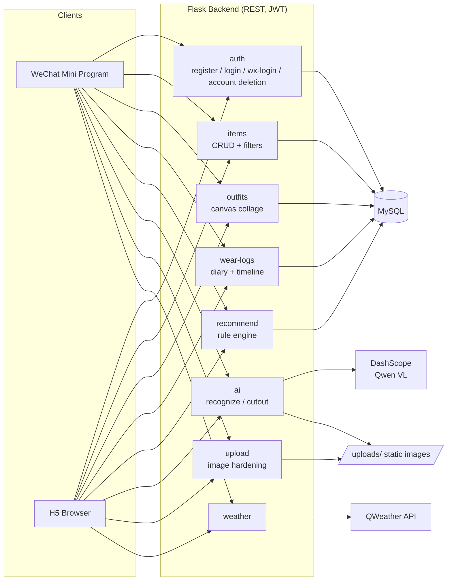
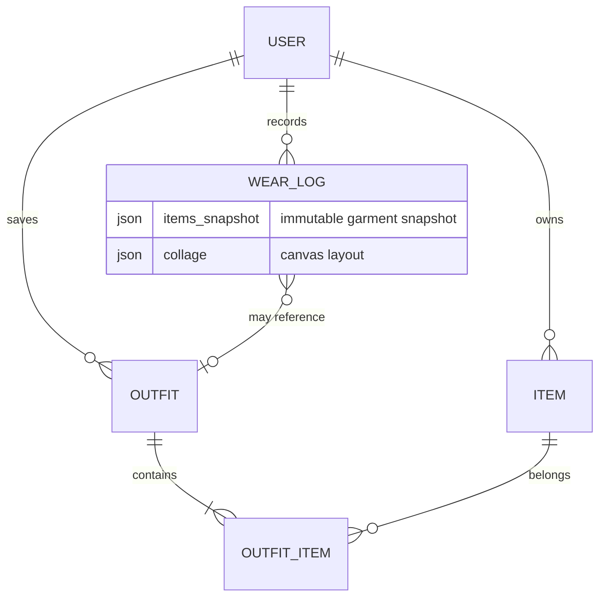

# YiJian XiaoZha · Smart Wardrobe & Outfit Diary

<p align="center">
  <b>[English]</b> · <a href="README.zh-CN.md">中文</a>
</p>

> A full-stack lifestyle app that digitizes your wardrobe: photograph your clothes once, then mix & match outfits on a canvas, check in what you wore each day with a mood diary, and get personalized daily outfit recommendations — all on WeChat Mini Program and H5.


<!-- TODO(shary): 补一张产品主视觉/手机样机图，建议放 docs/screenshots/hero.png
<p align="center">
  
</p>
-->

## Highlights

- **AI-powered batch item entry** — pick up to 30 photos at once; each one is uploaded, background-removed locally (rembg, `isnet-general-use`, runs on CPU) and recognized (type / color / season / occasion) by a Qwen vision-language model, with results validated against backend enums. Items are saved immediately as *pending review* ("save first, fix later"), so users only correct what the AI got wrong. The pipeline runs two photos concurrently with per-photo progress, falls back gracefully (original image if cutout fails, *Unclassified* if recognition fails), resumes from the failed step after a network drop without re-uploading or re-spending AI quota, and is protected by hourly + daily per-user AI quotas.
- **Wardrobe multi-select** — enter selection mode via a *Manage* button or a long press (implemented on raw touch events so list scrolling is never blocked); batch-delete in one transaction with an impact preview ("2 of these items are in 3 saved outfits") and a 5-second undo backed by soft deletes, plus batch-confirm of pending items that skips *Unclassified* ones.
- **Manual outfit canvas** — drag, scale, and layer wardrobe items into a collage (`collage` JSON: position, width, z-index per item); the exact layout is persisted with both saved outfits and diary entries, and rendered back pixel-perfect.
- **Explainable rule-based recommendations** — daily 3-outfit suggestions filtered by live temperature → season mapping, occasion matching, shoe/outerwear pairing, with down-weighting of items worn in the last 7 days; every suggestion ships with a human-readable reason string.
- **Lightweight wear diary & timeline** — one tap to log today's outfit; mood emoji, one-line note and an optional photo are all optional. Timeline groups entries by month with per-date filtering; snapshots keep deleted garments visible in history.
- **Production-minded engineering** — JWT auth with WeChat one-tap login, per-user rate limiting, upload hardening (Pillow re-validation, EXIF/GPS stripping, dimension caps, directory-traversal guards), soft-delete consistency, Alembic migrations, gunicorn + nginx deployment configs, daily backup script, and a debug-only HTML API console.

## Screenshots

<table>
  <tr>
    <td></td>
    <td></td>
    <td></td>
    <td></td>
    <td></td>
  </tr>
  <tr>
    <td align="center">Batch AI upload</td>
    <td align="center">Daily recommendation</td>
    <td align="center">Wardrobe</td>
    <td align="center">Outfit canvas</td>
    <td align="center">Wear diary timeline</td>
  </tr>
</table>

## Tech Stack

| Layer | Technology |
|---|---|
| Frontend | uni-app (Vue 3 `<script setup>`) + Pinia + Vite → WeChat Mini Program / H5 |
| Backend | Flask 3 + SQLAlchemy + Flask-Migrate (Alembic) + Flask-JWT-Extended |
| Database | MySQL (utf8mb4 / InnoDB) via PyMySQL |
| AI | Qwen VL (DashScope) for clothing recognition; rembg for on-device-server background removal |
| External API | QWeather (real-time weather for temperature-aware recommendations) |
| Testing | pytest — 218 tests on in-memory SQLite, no live DB required |
| Deployment | gunicorn (1×8) behind nginx; systemd unit & daily mysqldump backup in `deploy/` |

## Architecture



Key data model relations:



## Getting Started (Local H5)

Prerequisites: Python 3.12+, Node 18+, MySQL 8.

```bash
# 1. Database (schema.sql creates the `smart_wardrobe` database itself)
mysql -u root -p < schema.sql
cd server && flask db stamp head     # mark migrations as up-to-date for a fresh DB

# 2. Backend (http://127.0.0.1:5001)
cp .env.example .env                 # then fill DB_*, SECRET_KEY, JWT_SECRET_KEY
pip install -r requirements.txt
python run.py

# 3. Frontend (http://localhost:8081)
cd ../client
npm install
npm run dev:h5
```

Health check: `GET /api/health` → `{ "status": "ok", "database": "ok" }`

Optional `.env` keys unlock extra features: `DASHSCOPE_API_KEY` (AI recognition), `QWEATHER_API_KEY` (live weather), `WX_APPID` / `WX_APPSECRET` (WeChat login, Mini Program only).

## Testing

```bash
cd server && python -m pytest -q
```

218 tests cover auth (incl. WeChat login & account deletion), item CRUD, the batch-upload review flow, batch delete / undo / confirm, outfit collage validation, wear-log snapshots, the recommendation engine, upload security, rate limiting, weather, and AI endpoints — all against in-memory SQLite.

## Production Deployment

Deployment playbook, nginx config, systemd unit and backup script live in [`deploy/`](deploy/README.md).

## Roadmap

- [ ] Upgrade the rule engine to a hybrid recommender (tag-based content matching × wear-frequency collaborative filtering) with an A/B evaluation
- [ ] Content-safety moderation for user-generated diary text & photos
- [ ] Wardrobe utilization analytics (cost-per-wear, seasonal usage)
- [ ] Weather-API-driven recommendation refinement
- [ ] Quantitative evaluation of AI recognition accuracy (raw photo vs. background-removed) on a labeled clothing photo set
- [ ] Move image storage from local disk to object storage (OSS/COS) with CDN and signed URLs for private diary photos

## Project Status

This project evolved from **MoChu (魔橱), an earlier smart-outfit prototype that won Third Prize in the Jilin Provincial Round of the 27th China Robotics and Artificial Intelligence Competition**. It was then rebuilt from the ground up as a production-oriented app and is also the basis of the author's undergraduate thesis.

Core flows are feature-complete and covered by automated tests; the Mini Program release (ICP filing, privacy compliance text, WeChat review) is in progress. See [`docs/PROJECT_CONTEXT.md`](docs/PROJECT_CONTEXT.md) for the full engineering context document.
