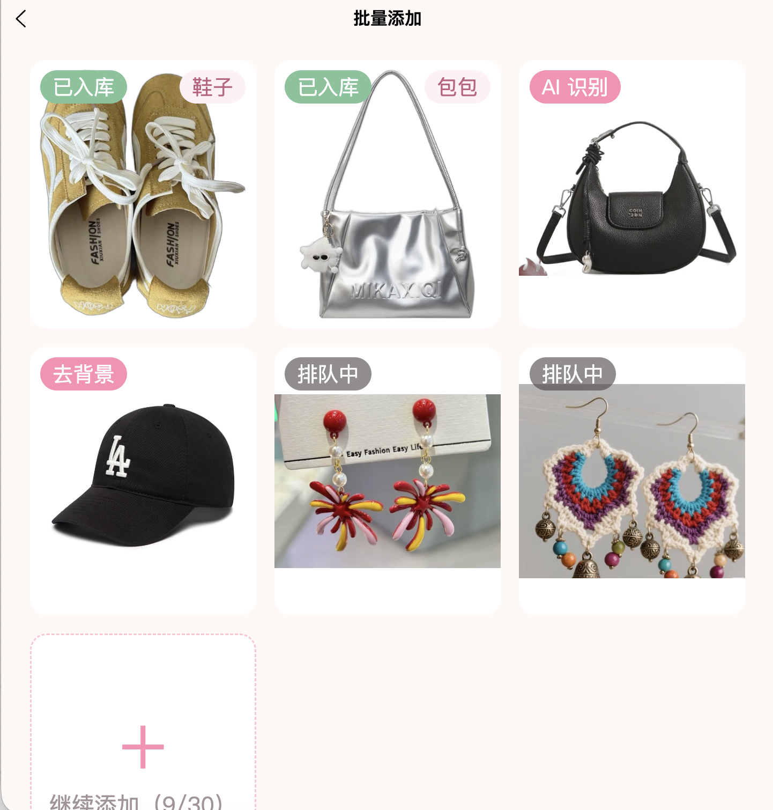
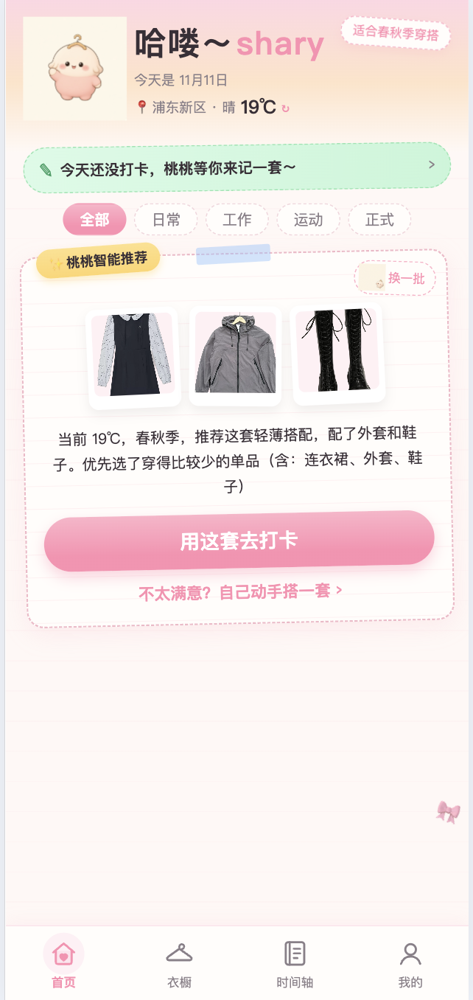
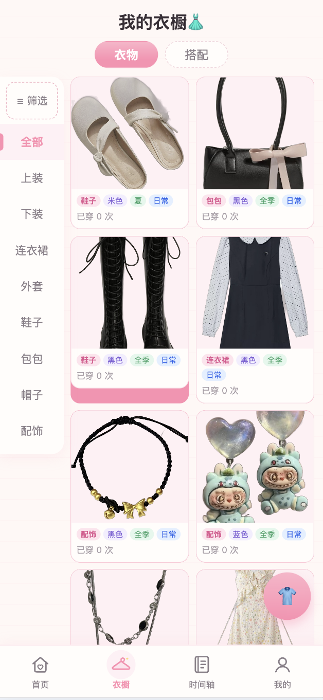
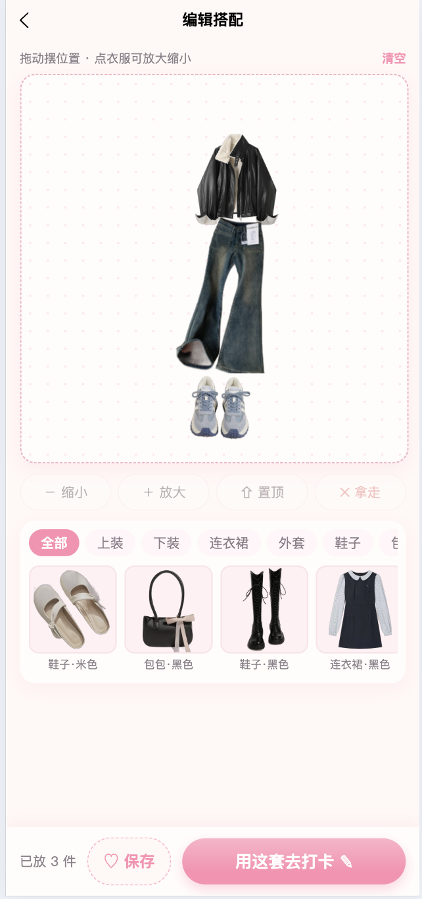
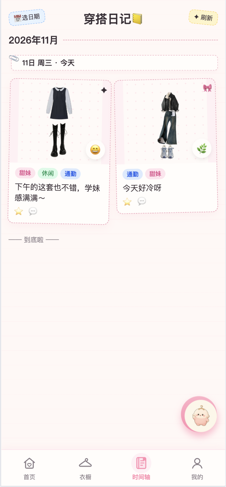
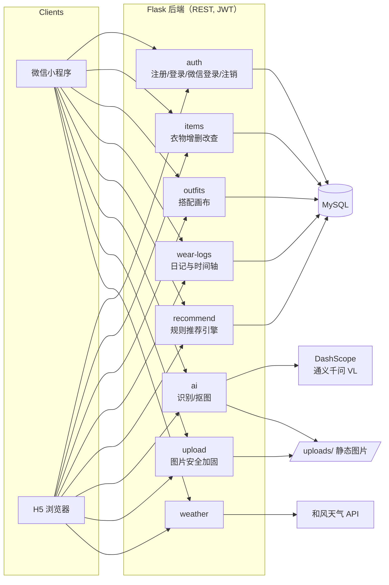
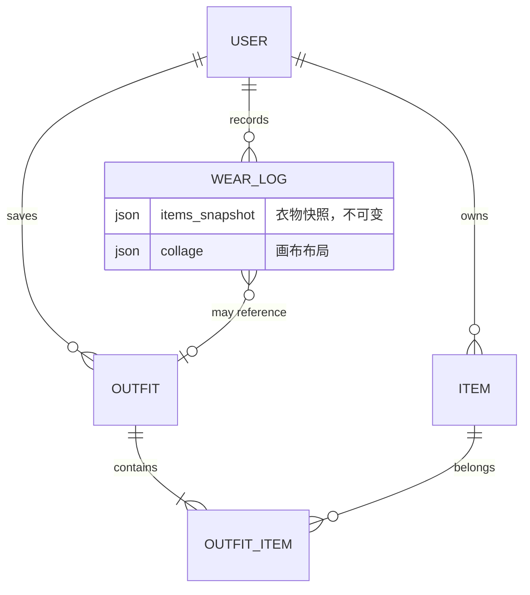

# 衣笺小札 · 智能衣橱与穿搭日记

<p align="center">
  <a href="README.md">English</a> · <b>[中文]</b>
</p>

> 一款全栈个人生活应用：衣服拍照入库一次，之后可以手动搭配、每日打卡穿搭并记录心情日记，还能获得个性化今日穿搭推荐。同时支持微信小程序和 H5 网页端。


<!-- TODO(shary): 补一张产品主视觉/手机样机图，建议放 docs/screenshots/hero.png
<p align="center">
  
</p>
-->

## 核心亮点

- **AI 批量入库**：一次最多选 30 张照片，每张自动完成上传 → 本地模型抠图去背景（rembg `isnet-general-use`，CPU 运行）→ 通义千问视觉大模型识别分类/颜色/季节/场合（经后端枚举二次校验）。采用「先存后改」：识别完直接存为「待确认」，用户只需改 AI 识别错的地方。两张并发处理、逐张显示进度；抠图失败用原图、识别失败存为「未分类」；断网后从失败的那一步继续，不重复上传、不重复消耗 AI 次数；AI 接口按用户设每小时 + 每天两级限额。
- **衣橱多选管理**：点「管理」或长按卡片进入多选（长按基于原生触摸事件实现，不影响列表滑动）；批量删除在一个事务内完成，删除前提示「其中 2 件在 3 套已保存的搭配里」，删除后 5 秒内可撤销（基于软删除）；「待确认」中可批量确认入库，「未分类」的自动跳过。
- **手动搭配画布**：拖动、缩放、叠放衣物拼成拼贴（`collage` JSON 记录每件的位置/宽度/层级）；布局随搭配方案和日记一起持久化，可像素级还原展示。
- **可解释的规则推荐**：每日 3 套穿搭建议——实时温度映射季节、场合匹配、自动配鞋配外套、近 7 天穿过的单品降权；每套建议都附带可读的推荐理由。
- **轻量穿搭日记与时间轴**：一键记录今日穿搭；心情 emoji、一句话、现场照全部选填。时间轴按月分段、支持按日期筛选；衣物快照保证删除衣物后历史记录仍完整可看。
- **面向生产的工程细节**：JWT 鉴权 + 微信一键登录、按用户/IP 限流、上传安全加固（Pillow 真实格式校验、去除 EXIF/GPS 元数据、尺寸上限、目录穿越防护）、软删除一致性、Alembic 数据库迁移、gunicorn + nginx 部署配置、每日备份脚本、仅 DEBUG 暴露的 HTML 接口调试台。

## 界面截图

<table>
  <tr>
    <td></td>
    <td></td>
    <td></td>
    <td></td>
    <td></td>
  </tr>
  <tr>
    <td align="center">AI 批量入库</td>
    <td align="center">今日推荐</td>
    <td align="center">我的衣橱</td>
    <td align="center">搭配画布</td>
    <td align="center">穿搭时间轴</td>
  </tr>
</table>

## 技术栈

| 层级 | 技术 |
|---|---|
| 前端 | uni-app（Vue 3 `<script setup>`）+ Pinia + Vite → 微信小程序 / H5 |
| 后端 | Flask 3 + SQLAlchemy + Flask-Migrate（Alembic）+ Flask-JWT-Extended |
| 数据库 | MySQL（utf8mb4 / InnoDB），驱动 PyMySQL |
| AI | 通义千问 VL（DashScope）衣物识别；rembg 服务端抠图 |
| 外部服务 | 和风天气（实时气温驱动推荐） |
| 测试 | pytest —— 218 项测试，内存 SQLite，不依赖业务库 |
| 部署 | gunicorn（1×8）+ nginx；`deploy/` 含 systemd 单元与每日 mysqldump 备份脚本 |

## 架构图



数据模型关系：



## 本地运行（H5）

环境要求：Python 3.12+、Node 18+、MySQL 8。

```bash
# 1. 数据库（schema.sql 已包含建库语句）
mysql -u root -p < schema.sql
cd server && flask db stamp head     # 全新建库时标记迁移为最新版本

# 2. 后端（http://127.0.0.1:5001）
cp .env.example .env                 # 填写 DB_*、SECRET_KEY、JWT_SECRET_KEY
pip install -r requirements.txt
python run.py

# 3. 前端（http://localhost:8081）
cd ../client
npm install
npm run dev:h5
```

健康检查：`GET /api/health` → `{ "status": "ok", "database": "ok" }`

可选 `.env` 配置解锁附加能力：`DASHSCOPE_API_KEY`（AI 识别）、`QWEATHER_API_KEY`（实时天气）、`WX_APPID` / `WX_APPSECRET`（微信登录，仅小程序端）。

## 测试

```bash
cd server && python -m pytest -q
```

174 项测试覆盖：认证（含微信登录与账号注销）、衣物增删改查、批量上传核对流程、批量删除 / 撤销 / 确认、搭配 collage 校验、日记快照、推荐引擎、上传安全、限流、天气与 AI 接口——全部运行在内存 SQLite 上。

## 生产部署

部署手册、nginx 配置、systemd 单元与备份脚本见 [`deploy/`](deploy/README.md)。

## 路线图

- [ ] 将规则推荐升级为混合推荐（标签内容匹配 × 穿着频率协同过滤），并做对比实验
- [ ] 用户生成内容（日记文字/照片）接入内容安全检测
- [ ] 衣橱利用率统计（单次穿着成本、季节使用率）
- [ ] 天气 API 驱动的推荐优化
- [ ] 在标注好的衣物照片集上量化评估 AI 识别准确率（原图 vs 抠图后）
- [ ] 图片存储从服务器本地迁移到对象存储（OSS/COS），配合 CDN 加速，日记私人照片使用签名链接访问

## 项目状态

本项目由早期原型「魔橱智能穿搭平台」发展而来，该原型曾获**第二十七届中国机器人及人工智能大赛吉林省赛区三等奖**；之后面向真实上线从零重构，同时作为作者的本科毕业设计。

核心功能已完成并被自动化测试覆盖；小程序上线（ICP 备案、隐私合规文本、微信审核）进行中。完整工程上下文见 [`docs/PROJECT_CONTEXT.md`](docs/PROJECT_CONTEXT.md)。
